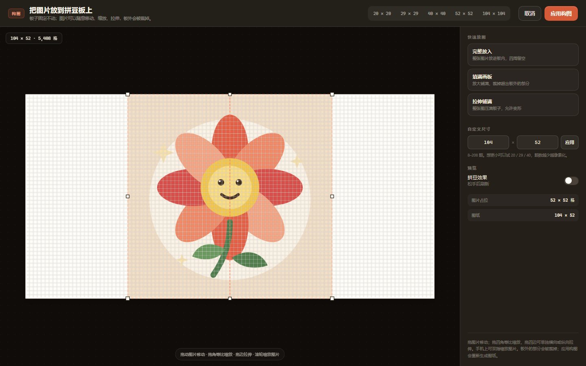
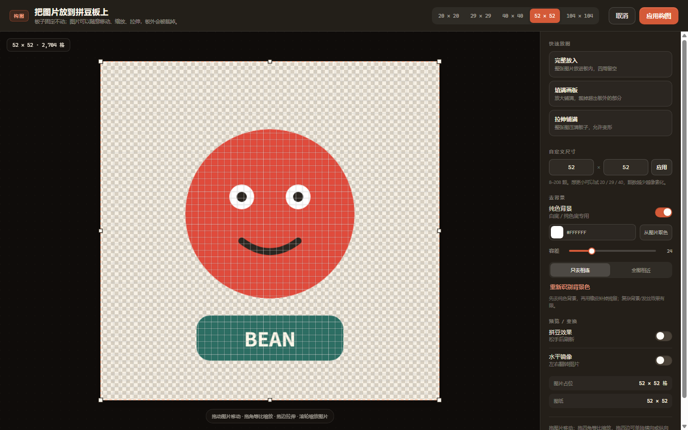
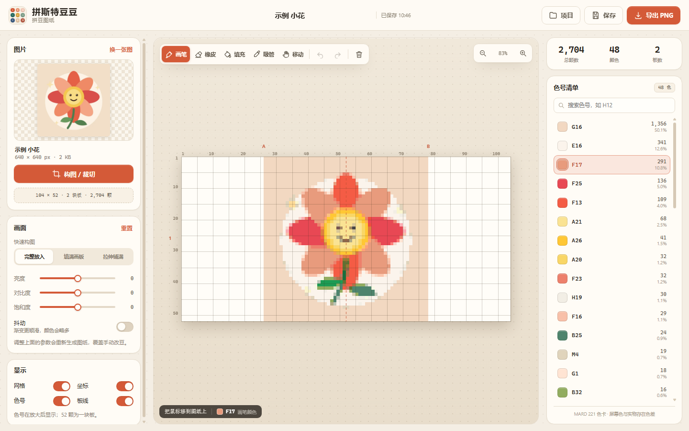
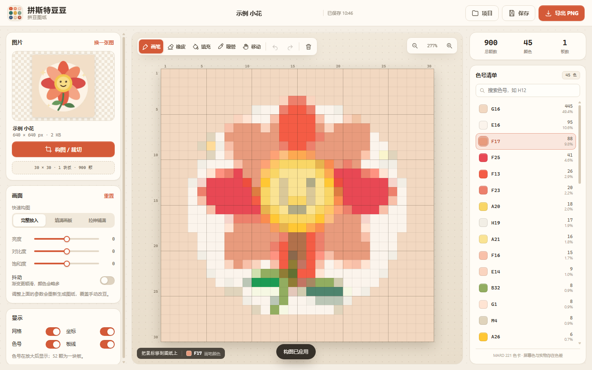
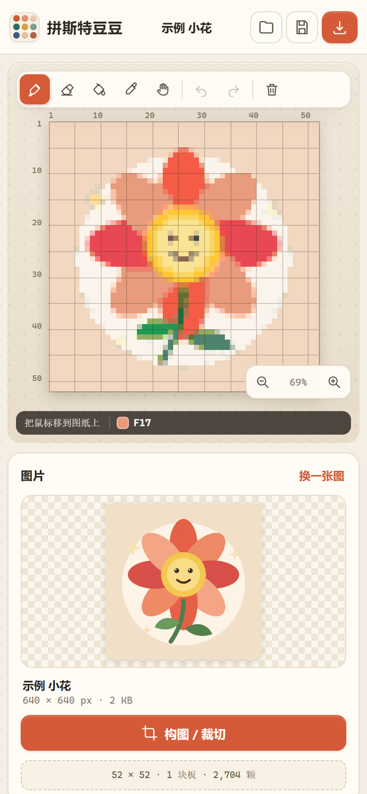

# 拼斯特豆豆 · 拼豆图纸

上传一张图片，先在拼豆板上调整构图，再自动匹配 **MARD 221 色号**，生成能照着拼的拼豆图纸：带网格坐标、每格色号、每种颜色的颗数统计，可手动改豆，可导出 PNG。

图片只在浏览器本机处理，不上传服务器。











## 运行

直接双击 `index.html` 即可，不需要安装依赖、不需要构建。

也可以在当前目录起一个静态服务器：

```bash
python -m http.server 8080
```

然后打开 `http://127.0.0.1:8080`。

推荐使用较新的 Chrome / Edge。Safari 也可运行，但本机存储配额和 WebP 编码支持可能不同。

## 功能

- **先在板上放图，再出图**：上传后自动进入构图编辑器。
  - 豆板固定不动；整张图片可以在板上拖动、四角等比缩放、四边单向拉伸，板外部分会被裁掉。
  - 图片缩小时，板内没被覆盖的格子就是空白豆位；可以把整张图完整放进去，也可以放大铺满。
  - 快速放图：**完整放入**（整图进板、四周留空）/ **填满画板**（放大裁切）/ **拉伸铺满**（整图压满、允许变形）。
  - 「拼豆效果」开关可以随时把板内切换成实际拼豆配色预览；松手后刷新。
  - 「水平镜像」一键左右翻转图片，镜像状态会跟项目一起保存。
  - 点击「应用构图」才写入图纸；「取消」不改变原来的图纸。之后也可以随时点「构图 / 裁切」重新调整。
- **去背景**：纯色/白底图片可以在构图编辑器里一键去除背景。
  - 自动识别背景色，也可以从图片上点选取色。
  - 容差可调；「只去相连」保留被主体包住的同色区域（例如白眼球），「全图相近」连内部相近色一起去掉。
  - 棋盘格实时预览透明区域；应用后空白处就是空豆位。
  - 参数随项目保存；复杂背景仍建议用橡皮补。
- **导入**：点击上传、拖拽图片、`Ctrl+V` 粘贴；手机可直接从相册选图。
- **尺寸**：20×20（迷你）、29×29（小板）、40×40（小图）、52×52（1 块板）、104×104（4 块板）、52×104、104×52，或自定义 8–208 颗。
  - 构图编辑器里也能直接切 20 / 29 / 40 / 52 / 104，或输入任意宽×高（例如 30×30）。
  - 颗数越少，图案越像素化、细节越少，但拼起来更快；52×52 觉得大时，先试 29×29 或 40×40。
  - 每 52 颗画一条橙红色板线，并标出 A/B/C… 与 1/2/3… 板号；一块板拼完可以接着拼下一块。
- **色卡**：MARD 221 色号，CIELAB + CIEDE2000 最近色匹配；颜色数量不设上限，尽量还原原图。
- **画面**：亮度、对比度、饱和度、抖动（Floyd–Steinberg）。
- **图纸**：自适应网格、每 5 格粗线、行列坐标、板线、放大后显示每格色号。
- **编辑**：画笔、橡皮、油漆桶、吸管、清空；撤销/重做；右键快速擦除；移动工具 + 空格拖拽。
- **统计**：总颗数、颜色数、板数；右侧色号清单按用量排序，显示色号、颗数和占比，可搜索、点击取色。
- **导出 PNG**：一张完整的打印用图纸，含标题、尺寸、分板线、四周坐标、每格色号、色号清单、颗数/占比、生成时间。
- **项目**：构图、配色、手动改豆都自动保存到浏览器本机（最多 12 个），刷新或下次打开自动回到上次的图纸。
- **响应式**：桌面三栏；手机单列，画布置顶；构图编辑器支持单指拖图、双指缩放图片。

## 快捷键

| 操作 | 快捷键 |
| --- | --- |
| 画笔 / 橡皮 / 油漆桶 / 吸管 / 移动 | `B` / `E` / `G` / `I` / `H` |
| 临时移动画布 | 按住 `空格` 拖拽 |
| 撤销 / 重做 | `Ctrl+Z` / `Ctrl+Shift+Z` 或 `Ctrl+Y` |
| 保存 | `Ctrl+S` |
| 适应窗口 | `0` 或双击画布 |
| 放大 / 缩小 | `+` / `-`，或滚轮 |
| 取色 | `I`，或按住 `Alt` 点击 |
| 快速擦除 | 右键点击/拖拽 |
| 构图编辑器：移动图片 | 拖动图片 |
| 构图编辑器：缩放 / 拉伸 | 拖四角 / 拖四边，滚轮或双指缩放图片 |
| 构图编辑器：取消 | `Esc` 或「取消」 |

## 实现说明

纯静态前端，无第三方依赖：

```text
index.html      页面结构
styles.css      视觉样式与响应式布局
app.js          上传、板上放图、去背景、采样、生成、画布、编辑、导出、项目存储
color.js        sRGB→Lab、CIEDE2000、最近色匹配
palettes.js     MARD 221 色卡数据
LICENSE-DATA.txt  色卡数据 MIT 许可
screenshot*.png  界面截图
```

几个关键点：

- **构图**：图片位置用豆板格坐标保存（`frame`，整张图在板上的 x/y/宽/高），板子尺寸固定。采样时反推每个豆格覆盖的图片区域；图片没覆盖到的豆格留空，板外部分自动裁掉。
- **默认完整放入**：新图默认按 contain 放进板内，不会被裁成板子比例；点「填满画板」才会放大裁切。
- **纯色去背景**：从图片边缘统计主色作为背景色，按 RGB 距离生成 mask；「只去相连」从四条边做 flood fill，避免误删主体内部同色区域。处理结果在降采样前以 alpha 参与采样，空白豆位自然产生。背景参数存在项目设置里，不额外存 mask 大文件。
- **降采样**：按格子覆盖的原图像素做面积加权平均（alpha 也参与），不是简单取最近点，边缘更干净。
- **颜色匹配**：先按 Lab 欧氏距离取 16 个候选，再用 CIEDE2000 精确比较。比 RGB 距离更符合人眼，也比 10k 格 × 221 色全量 CIEDE2000 快得多。
- **原图缓存**：上传的原图会压到最长边 1200px 的 WebP 再存本机，用于下次继续调参；保存的是图纸索引而非整张图，项目体积较小。
- **画布**：图案以 1 格 = 1 像素的离屏画布生成，再按需缩放绘制；网格、坐标、色号、板线是叠加层，所以大图也流畅。
- **存储**：`localStorage`。空间不足时会先清理旧图纸的原图，再淘汰最旧的图纸；单张图纸仍可编辑和导出。

## 已知范围 / 可以继续加

- 去背景目前针对**纯色/白底**；渐变背景、发丝、复杂实景的分离效果有限，需要配合橡皮手动修。
- 板上放图暂不支持旋转；图片最大缩放为板子长边的 6 倍。
- 颜色不设上限，所以一张简单插画也可能用到几十种相近色（MARD 221 里本身有不少近似色）。如果更在意采购/分拣成本，可以加「合并相近色」或「最多 N 色」开关。
- 暂未做 A4 分页 1:1 打印；当前导出的是高分辨率 PNG，可以在图片查看器里打印。
- 暂只内置 MARD 221；色卡数据结构是可扩展的，后面可加 MARD 291、COCO、漫漫、Artkal 等。

## 色卡来源

MARD 221 数据来自 [HansBug/pindou-color-data](https://github.com/HansBug/pindou-color-data) 的 `mard-221-alfonse-doudou`（Alfonse + 豆豆工坊核对版），MIT License，见 [LICENSE-DATA.txt](LICENSE-DATA.txt)。

色值来自公开色卡整理，屏幕显示与实物豆子存在色差，实际采购请以品牌实物色卡为准。
